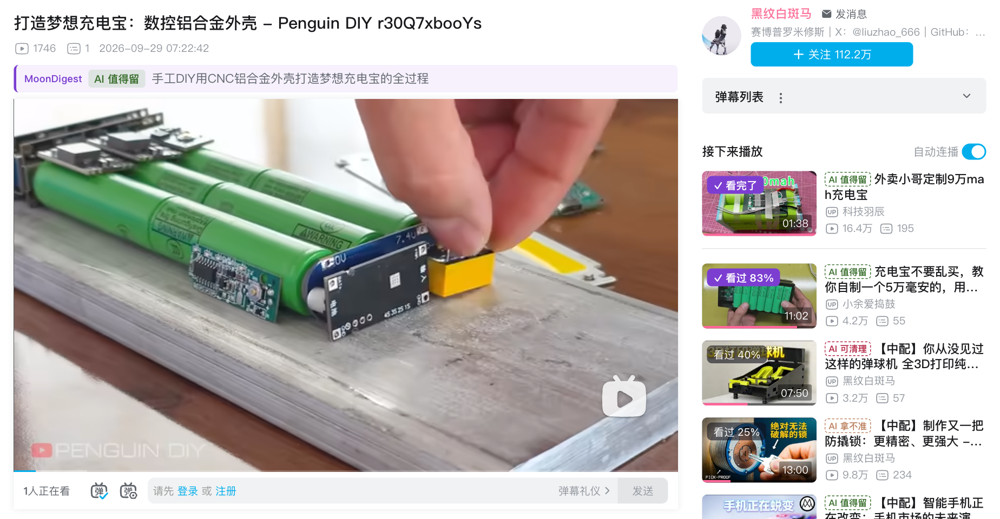
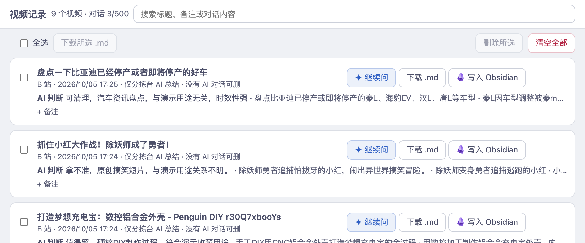
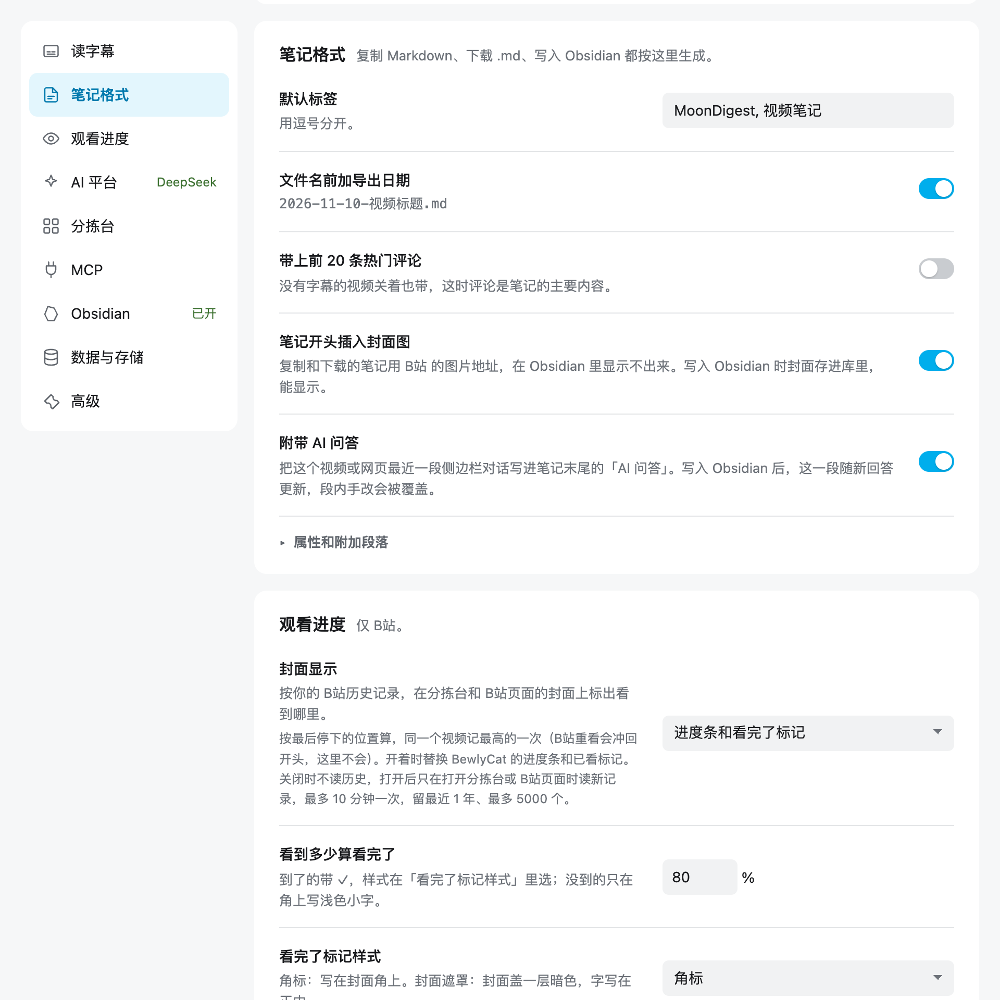

<div align="center">


# MoonDigest · 月团视频摘读

收藏了却没看的视频、想读的网页，用 AI 帮你读完、整理好，挑出真正要看的。

[](https://developer.chrome.com/docs/extensions/develop/migrate/what-is-mv3)
[](extension/manifest.json)
[](#功能)
[](LICENSE)

</div>

长视频很难判断值不值得看，收藏夹也越存越多、越来越少打开。MoonDigest 是一个 Chrome 扩展，做三件事：

- **读**：把视频变成能读的文字。看字幕、让 AI 总结、接着追问，或者在专注模式里边看边读。普通网页也能让 AI 读正文、总结和追问。
- **理**：把 B站收藏夹交给分拣台。AI 先看标题、再读字幕，告诉你每个视频值不值得留。你决定保留还是取消收藏，再把想先看的加入「待播」。
- **记**：给视频写一句备注，AI 对话按视频和网页存好，都能导出成 Markdown。用 Obsidian 的话可以直接写入库里，这一项可选。

所有数据都留在你的浏览器里，没有作者的服务器。

<p align="center">
  
</p>

## 快速开始

1. **安装**：从 [Chrome 应用商店](https://chromewebstore.google.com/detail/bnjihpbocpimaipifanfkjjpfdbigggd) 添加，以后自动更新。想用最新版，或者不方便上商店，见「安装与更新」里的 zip 包。
2. **配置 AI**：点插件图标 → 设置 → 「AI 平台」 → 「+ 添加平台」。选一个预设，地址和模型会自动填好，再填 API Key，点「测试连接」，最后点「保存」。浏览器问能否访问这个地址时点允许。
3. **登录 B站**：B站只给登录用户看字幕，AI 字幕也一样。没登录时插件拿不到字幕，分拣台也读不到你的收藏夹。
4. **试一下**：打开一个 B站或 YouTube 视频，点插件图标里的 **✦ AI 总结**。侧边栏打开，输入框里填好总结要求，点发送。普通网页也一样，第一次用时在侧边栏点「允许读取网页」。

带 ✦ 的按钮会调用 AI，花你自己的 API 额度。其他按钮都不会。不配 AI 也能读字幕、下载字幕、用专注模式、导出笔记和手动分拣。

## 功能

### 读：字幕、AI 侧边栏、专注模式

- **弹窗**：在视频页点插件图标，能看字幕、复制或下载，打开 AI 总结、专注模式、分拣台和摘读记录。在普通网页上能打开 AI 总结，也能复制 Markdown、下载 .md 或写入 Obsidian：内容和侧边栏导出的网页笔记一样，是正文加上这个网页最近一段对话的 AI 问答（按「附带 AI 问答」设置）。点了图标就能读这个网页，不用先点「允许读取网页」；读不了的页面（找不到正文、Chrome 应用商店）按钮变灰并写原因。
- **字幕**：支持人工、AI 和自动生成的字幕。YouTube 可以设默认语言，没有这种语言时用机器翻译。视频没有字幕时，AI 改用简介和热门评论来总结。
- **AI 侧边栏**：在 B站和 YouTube 的视频页读字幕和评论，在普通网页读正文（系统提示词、AI 总结要求和快捷追问在设置页分视频和网页两份）：第一次在网页上用时点侧边栏里的「允许读取网页」，Chrome 会问能否读取所有网站，允许一次以后所有网页都直接读；在这个网页上点过插件图标的话，不允许也能读它，直到它跳到别的网址。从弹窗点的 ✦ AI 总结会等允许、读到正文后自动发送（这之间改了输入框就不发）。浏览器内置页、扩展页和本地文件读不了。弹窗和播放器上的 ✦ AI 总结只把总结要求填进输入框，由你点发送；侧边栏空对话里的 AI 总结按钮直接发送；这个视频已经有对话时，弹窗、播放器上的 ✦ 和专注模式的 AI 总结都直接打开那段对话。之后可以点快捷追问或直接提问。换视频或网页时侧边栏跟着切过去，上一个视频或网页的对话收成一栏「上一个视频：标题」「上一个网页：标题」，点开能看；离开网页的对话时，就算切到读不了的页面也收起来，这一栏一直留着，直到又离开另一段有对话的视频或网页。AI 还在回答时换视频、点「开启新对话」或打开别的对话，这条回答照样写进原来的对话。输入框里没发出的文字属于当前对话，换到别的对话时清空。整段对话可以复制、下载或写入 Obsidian，三个给的是同一篇视频笔记或网页笔记，带屏幕上这段对话。
- **专注模式**：视频在左，字幕在右，章节排在视频下面一行。字幕跟着播放滚动，点一句就跳到那里。字幕栏宽度有五档。四个按钮（AI 总结、主题、设置、退出）在你读的时候变淡。
- **导出**：复制 Markdown，下载 SRT 或 TXT。笔记带干净的链接、封面、作者、时长、发布日期和标签（设置页填的标签，B站视频还带你在分拣台打的标签）。

### 理：B站分拣台（仅 B站）

<p align="center">
  
</p>

点插件图标 → **打开B站分拣台**。第一次打开先勾选要分拣的收藏夹，B站「稍后再看」也可以勾。MoonDigest 只读取你勾选的收藏夹，没勾的不读内容。

分拣台回答两个问题。视频**留不留**，看收藏夹的判断标准，AI 给出 **值得留** / **可清理** / **拿不准**。留下的**怎么分**，看你的标签。

- AI 先 **✦ 标题粗看**，只看标题和简介，便宜。拿不准的再 **✦ 字幕细看**，读字幕，判断最可靠。你一个个或批量保留、取消收藏。
- **保留**只在 MoonDigest 里标记，B站收藏夹不变。**取消收藏**会真的在 B站取消，按 U 可以撤销。
- 想先看的按 E 加入「待播」，点一条就在分拣台里打开 B站视频页。
- 视频离开了你勾选的所有收藏夹时，它的 AI 判断、AI 总结、备注和标签先放进「已出分拣范围」，不会悄悄丢掉。
- 分拣过的视频，在 B站页面上也能看到你的标签。AI 判断要在设置页「B站分拣台」里打开才在 B站页面显示。

<p align="center">
  
</p>

四个步骤、批量操作、待播、其他视图、B站页面上的标记和快捷键见 [分拣台说明](docs/TRIAGE.md)。分拣台里按 `?` 看快捷键帮助。

### 观看进度（仅 B站，默认关）

在设置页「观看进度」里选「封面显示」：关 / 进度条 / 看完了标记 / 进度条和看完了标记。分拣台卡片和 B站页面上的视频封面都按这个显示。

- **进度条**：样式和 B站自己的一样。
- **看完了标记**：看够「看到多少算看完了」（默认 80%）就算看完了，封面写「✓ 看完了」（100%）或「✓ 看到 83%」。没到比例的写一个淡色的「看到 40%」。样式可选角标或封面遮罩。有看完了的视频时，分拣台多出「看完了」筛选。
- 进度来自你自己的 B站历史记录，读取方式见「隐私与数据」。

### 记：备注、摘读记录、Obsidian

- **备注**：在侧边栏、分拣台卡片或摘读记录页给视频写一句话。三处是同一份，导出时一起带上。
- **摘读记录**：按视频和网页列出 AI 对话、分拣台的 AI 总结和你的备注（备注只给视频）。每条可以复制 Markdown、下载 .md 或写入 Obsidian，三个给的是同一篇笔记（视频笔记或网页笔记，带最新一段对话）；可以搜索，选中多条后打包成 .zip 下载（每条一篇 .md，页面没开、生成不了完整笔记的那几条放 AI 笔记）或删除它们的 AI 对话（每条的「删除 AI 对话」、「删除选中的 N 个的 AI 对话」和「清空全部 AI 对话」都只删 AI 对话，AI 总结和备注留着）。视频和网页的对话都可以「继续问」：网页的会切到这个窗口里开着的那个网页（没开就新开），在侧边栏接着问。
- **星标和标签**：摘读记录里点标题前的星星加星标，「+ 标签」给一条或选中的几条打标签（视频和网页共用一套，最多 50 个），按星标和标签筛选。「✦ AI 打标签」（I）读问答原文给出建议，点「应用」才生效，U 撤销。加了星标的记录不被「清空全部 AI 对话」删，也不计入对话上限。星标和标签写进笔记开头的 `tags` 和 `starred`。
- **笔记格式**：设置页「笔记格式」里选笔记开头写哪些自带属性（标题、链接、UP 主、时长、发布日期等），加自己的属性（值里可以用 `{{site}}` 这类变量），还能在正文里留几个空段落给自己写。自带属性和空段落只用在视频笔记上；网页笔记固定写标题、链接、网站、作者、发布日期、导出日期和标签，自定属性两种笔记都带。
- **Obsidian（可选）**：不开也能复制、下载 Markdown。开了以后通过 Obsidian 插件 Local REST API 写入库里，默认放在 `MoonDigest/bilibili/` 和 `MoonDigest/youtube/`，一个视频一篇笔记；网页的笔记放在 `MoonDigest/网页/`，开头是标题、链接、网站、作者、发布日期，下面是正文和「AI 问答」。写入过一次之后，这个视频再写入都写到那篇笔记（文件名带日期也一样），新的 AI 问答自动更新到笔记末尾的「AI 问答」一段。弹窗、侧边栏和摘读记录页遇到笔记已经存在时，你选「整篇覆盖」「只更新 AI 问答」或「取消」。视频在 B站被删除或隐藏时，对话写成一篇单独的 AI 笔记。YouTube、B站分 P 视频和网页还没有笔记、页面又没开时，侧边栏和摘读记录页先问你：在后台打开页面再写完整笔记，还是只把对话写成一篇单独的 AI 笔记；复制和下载也这样问。关掉「附带 AI 问答」时照样写视频笔记，只是不带对话，也不另写 AI 笔记。写过笔记的视频或网页没开着时，确认框里只能选「只更新 AI 问答」。

<p align="center">
  
</p>

<p align="center">
  
</p>

## AI 平台

支持任意 OpenAI 兼容接口。预设会填好地址和默认模型，模型名可以改：

| 预设 | 默认模型 |
|---|---|
| DeepSeek | `deepseek-flash` |
| 智谱 GLM | `glm-4.7-flash` |
| Moonshot（Kimi） | `kimi-k2.6` |
| MiniMax | `MiniMax-M2.7-highspeed` |
| OpenAI 兼容 | `gpt-6-luna` |
| OpenRouter | `~google/gemini-flash-latest` |

可以加多个平台，在侧边栏的「选择 AI 平台」下拉框里切换。分拣台的 AI（标题粗看、字幕细看、✦ AI 打标签）也用那里选的平台；还没选过就用第一个启用的平台。用 DeepSeek、智谱和 Kimi 时，侧边栏对话和测试连接会关闭思考，分拣台是否思考由「开启思考」开关决定。

## 给 AI agent 用

Agent 查资料碰到视频，通常只能看标题和封面，要么把视频下载下来用 Whisper 转写。装了 MoonDigest，agent 就能借你浏览器的登录状态，一次拿到标题、简介、章节、带时间戳的逐句字幕和热门评论，还能截取任意一秒的画面（不带弹幕）。不下载视频，不会被 B站 412 或 YouTube 429 拦住，不花 AI 额度，读不到你的 API Key、笔记、对话和分拣结果。

```
            ┌─ skill：agent 自己驱动浏览器（ego、Claude in Chrome、Playwright…）
agent ──────┤        在视频页里 postMessage ──> MoonDigest 回 JSON / 截帧
            └─ MCP：Claude Code、Cursor、Codex 等 ──> moondigest-mcp ──> MoonDigest
```

先登录 B站（B站 只给登录用户看字幕，AI 字幕也一样），再二选一：

**skill**（agent 能驱动浏览器时）：把 [skills/moondigest](skills/moondigest/SKILL.md) 放进 agent 的 skills 目录，Claude Code 是：

```sh
git clone https://github.com/PathGao/MoonDigest.git
mkdir -p ~/.claude/skills && cp -r MoonDigest/skills/moondigest ~/.claude/skills/
```

**MCP**（任何 MCP 客户端，agent 不用会操控浏览器）：

1. 打开「设置 → 高级 → 允许 MCP 连接」。用 MCP 时再打开：开着时插件每分钟试连一次本机 `127.0.0.1:47823`，连上后插件后台会一直运行。不用时关掉，能省一点电和内存。
2. 装 MCP 服务（要 Node 20+，还没发布到 npm，先用本地路径）：

   ```sh
   git clone https://github.com/PathGao/MoonDigest.git
   cd MoonDigest/mcp && npm install
   claude mcp add moondigest -- node "$PWD/server.js"
   ```

   Cursor、Codex 的配置写法见 [mcp/README.md](mcp/README.md)。
3. 用的时候浏览器要开着。工具有两个：`get_video({ url })` 拿字幕和信息，`get_frame({ url, at })` 拿 `at` 秒的一帧。扩展最多开一个自己的后台标签页；`get_frame` 第一次在没显示过的标签页里截帧时，会把它切到前台截完再切回，屏幕会闪一下（Chrome 不给没显示过的标签页加载视频）。

不装 skill 也行，把这段提示词粘给 agent（用 MCP 时把第 1、2 步换成 get_video、get_frame）：

```text
需要了解 B站 或 YouTube 视频的内容时，用浏览器打开视频页，不要只看标题和封面，也不要下载视频。浏览器里装了 MoonDigest 扩展，按 https://github.com/PathGao/MoonDigest/blob/main/skills/moondigest/SKILL.md 的步骤做：
1. 在视频页执行文档里的 JS，用 moondigest-get 拿字幕、章节、简介和评论。
2. 按章节读字幕。要核对画面（图表、代码、屏幕上的文字）时，用 moondigest-frame 跳到对应秒数截一帧，图片别直接打印进上下文。
3. 结论带上时间戳（mm:ss）和能跳到那一刻的链接。
4. 没字幕、没登录 B站 或被限流时，告诉我原因，不要反复重试，一次只读一个视频。
```

接口的完整说明在 [docs/AGENT.md](docs/AGENT.md)。

## 安装与更新

支持 Chrome 和其他 Chromium 内核浏览器（只在 Chrome 上测试过），不支持 Firefox。网站支持 B站视频页、稍后再看和 YouTube 视频页。

- **Chrome 应用商店**（推荐）：[添加到 Chrome](https://chromewebstore.google.com/detail/bnjihpbocpimaipifanfkjjpfdbigggd)，自动更新。新版要等商店审核，通常比 GitHub 晚几小时到几天。
- **zip 包**：从 [Releases](https://github.com/PathGao/MoonDigest/releases/latest) 下载 `moondigest-vX.Y.Z-chrome.zip`，解压到一个以后不会移动的文件夹。打开 `chrome://extensions`，打开右上角「开发者模式」，点「加载已解压的扩展程序」，选这个文件夹。也可以克隆本仓库，加载其中的 `extension/` 目录。
- **zip 包更新**：下载新版 zip，解压后**覆盖原来的文件夹**，再到 `chrome://extensions` 点 MoonDigest 卡片上的刷新按钮。换一个文件夹加载，Chrome 会当成新扩展，原来的数据全部丢失。源码安装的话 `git pull` 后点刷新。
- 商店版和 zip 版在 Chrome 里是两个不同的扩展，数据不互通，二选一装就行。
- 装过商店版 Bilibili Obsidian Clipper 的话，先停用它，免得视频页出现重复按钮。

## 隐私与数据

- 设置、分拣结果、备注和对话都存在浏览器本地。API Key 也存在本地，不会出现在任何导出文件里。
- 插件只连这些地方：B站和 YouTube、你配置的 AI 平台、你本机的 Obsidian。允许读取网页以后，侧边栏开着时会在本机读它跟随的每个网页的正文；只有你提问或点 AI 总结时，正文才发给你选的 AI 平台。没有作者的服务器，没有统计。
- B站 和 YouTube 视频页上的网页脚本（包括你用的 AI agent）可以向插件要这个视频的信息、字幕、章节和热门评论，这些都是网站本来就给这个页面的数据。打开「允许 MCP 连接」后，插件还会连本机 `127.0.0.1:47823` 上的 MCP 服务（`mcp/`），只接受打开 B站 和 YouTube 视频页的请求。见「给 AI agent 用」。
- 分拣台只读取你勾选的收藏夹的内容。为了列出可勾选和可移动到的收藏夹，会读收藏夹的名称和数量。
- 分拣台的「关注」读你的关注列表、关注分组、每个人的粉丝数，以及关注的人新发的视频。只在你打开「关注」或点刷新时读。
- **观看进度**不是「关」时，会读你自己的 B站历史记录：只在你打开分拣台或 B站页面时读，最多 10 分钟一次，只读上次之后新增的部分。每个视频只在本地存两个数：看到百分之多少、最后观看时间，留 1 年、最多 5000 个（勾选收藏夹里的视频不删）。这些数据不发往任何地方。选「关」就不读。
- 每类数据怎么保存、会不会自动删，都写在设置页的「数据与存储」里。字幕缓存、AI 对话和观看进度有上限，超出自动删最旧的。分拣结果、备注和标签不会自动删。

| 权限 | 用途 |
|---|---|
| `storage`、`unlimitedStorage` | 在本地保存设置、分拣结果、字幕和对话 |
| `scripting` | 在视频页按需注入脚本（抓字幕、专注模式、播放器 ✦ AI 总结按钮）；在你授权的网页上提取正文 |
| `activeTab` | 还没允许读取网页时，你在网页上点插件图标，弹窗和侧边栏就能读这一个网页，直到它跳到别的网址（这项权限不弹提示） |
| `sidePanel` | 显示 AI 侧边栏 |
| `cookies` | 读取 B站的 `bili_jct`，分拣台改动收藏（取消收藏、移动、复制、新建收藏夹）和关注（取消或重新关注、特别关注、关注分组）时要用 |
| `declarativeNetRequest` | 给分拣台发往 B站接口的请求加上 B站的 Referer 和 Origin |
| `alarms` | 刷新关注列表时，后台被浏览器回收后从断点接着刷新，刷新完就清除；打开「允许 MCP 连接」后每分钟检查一次本机 MCP 服务，关掉就清除 |
| B站、YouTube 域名 | 读取视频信息、字幕和评论；读写你的收藏夹、稍后再看和关注列表；观看进度打开时读历史记录；在 B站页面显示分拣标记和观看进度 |
| `127.0.0.1`、`localhost` | 连接本机的 Obsidian Local REST API；打开「允许 MCP 连接」后连本机的 MCP 服务（`mcp/`） |
| 可选：任意 http/https 地址 | 你添加 AI 平台时针对那个地址申请；在侧边栏点「允许读取网页」时一次申请所有网站，用来读网页正文 |

## 常见问题

**「无字幕」和「字幕抓取失败」有什么区别？**
「无字幕」是视频本身没有字幕，AI 会改用简介和热门评论总结。「字幕抓取失败」是有字幕但没拿到，通常是断网、超时或字幕链接过期，稍后重试即可。这时 AI 侧边栏照样按标题、简介和评论回答，视频页、分拣台和摘读记录写的笔记照样按简介和热门评论写，开头注明「字幕抓取失败：原因」；分拣台细看的卡片也写「字幕抓取失败：原因，按简介和评论判断」。B站 限流不算字幕抓取失败：视频页和侧边栏用红字提示「B站限流，请稍后再试」，过一会儿点「重试」或「刷新」；分拣台会等一会儿再试同一个视频。都不会写没有字幕的笔记。

**提示「字幕时间轴到 …，视频长 …，字幕时间可能对不上」**
字幕的时间范围和视频时长差得多，可能是给另一个剪辑版本做的字幕，或只覆盖了视频的一部分。这种字幕多数仍然可用：视频页、AI 侧边栏、分拣台细看和笔记都照样用它，只是不存进字幕缓存。分拣台细看的卡片和「逐个视频笔记」的结果列表也会写这句。

**侧边栏在网页上读不出正文？**
第一次用时侧边栏写「读取网页正文要先允许一次，之后所有网页都能直接读」，点「允许读取网页」并在 Chrome 的弹窗里允许。不想给所有网站，就不点，侧边栏仍能用在 B站和 YouTube 视频页上。正文由 [Defuddle](https://github.com/kepano/defuddle) 在你的浏览器里提取，不联网。浏览器内置页（`chrome://`）、扩展页、本地文件和 Chrome 应用商店读不了；页面上找不到正文时写「读取网页失败：没有找到正文」。

**B站提示「未登录 B站，拿不到字幕」**
B站不给未登录的请求返回字幕。登录 B站后刷新视频页即可。

**YouTube 提示「YouTube 限流，请稍后再试」**
YouTube 短时间内收到太多请求时会暂时拒绝。插件会稍等重试一次。仍然失败就过几分钟再点「刷新」，长时间不恢复时换个网络。

**YouTube 提示「该视频需要登录或年龄验证」**
插件用你页面里已登录的播放器取字幕，你能在 YouTube 正常播放的视频一般都能拿到。会员专享视频需要你本人是会员。

**YouTube 提示「未能读取网页播放数据」**
插件没有读到网页的播放数据，补发的请求又被 YouTube 拒绝，常见于机房 IP。请刷新网页后重试。网页能正常播放的视频不会出现这条提示；能播放但没有字幕的视频显示「视频没有字幕」。

**为什么保存 AI 平台时浏览器会弹窗？**
插件没有预先申请访问所有网站，你添加一个 AI 平台时只申请那一个地址。拒绝后 AI 请求会失败，侧边栏会提示重新授权。

**怎么连接 Obsidian？**
在 Obsidian 社区插件里装好 **Local REST API with MCP**，打开 **Enable Non-encrypted (HTTP) Server**（地址一般是 `http://127.0.0.1:27123`），复制 API Key，填进设置页「Obsidian」一节，打开「启用写入 Obsidian」，点「测试连接」后保存。

## 路线图

- 问 AI：用一句话描述需求，AI 从收藏夹里挑出带理由的视频清单，你再决定怎么处理
- YouTube 播放列表的批量阅览

## 贡献

欢迎提 [issue](https://github.com/PathGao/MoonDigest/issues)。报 bug 时请写清楚视频链接、浏览器版本和复现步骤。改代码、跑自检和打包见 [CONTRIBUTING.md](CONTRIBUTING.md)。

## 请杯咖啡助力UP开发

<p align="center">
  
  &nbsp;&nbsp;
  
</p>

## 致谢

- 基于 [haixiong1997/Bilibili-Obsidian-Clipper](https://github.com/haixiong1997/Bilibili-Obsidian-Clipper)（MIT）。
- YouTube 字幕的取法参照 [yt-dlp](https://github.com/yt-dlp/yt-dlp)。
- 感谢 [oil-ui](https://github.com/oil-oil/oil-ui) 在多轮 UI 设计迭代中的支持。

## 许可

Copyright (C) 2026 PathGao

MoonDigest 以 [GPL-3.0](LICENSE) 发布。来自上游的部分保留原有的 MIT 许可声明，见 [THIRD_PARTY_NOTICES.md](THIRD_PARTY_NOTICES.md)。

## 免责声明

本工具只在你已登录 B站、且有访问权限的前提下读取和修改你自己的收藏数据。所有请求都通过你自己的浏览器和 cookie 发出。请遵守 B站用户协议与相关法律法规，使用后果由使用者自行承担。
