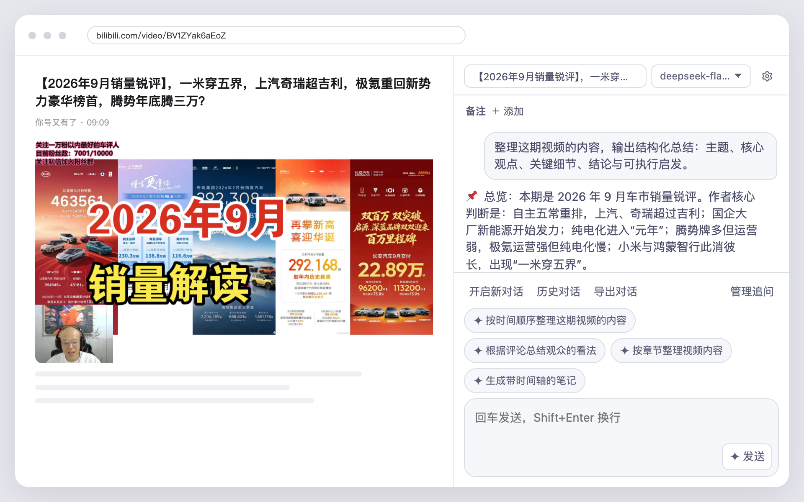
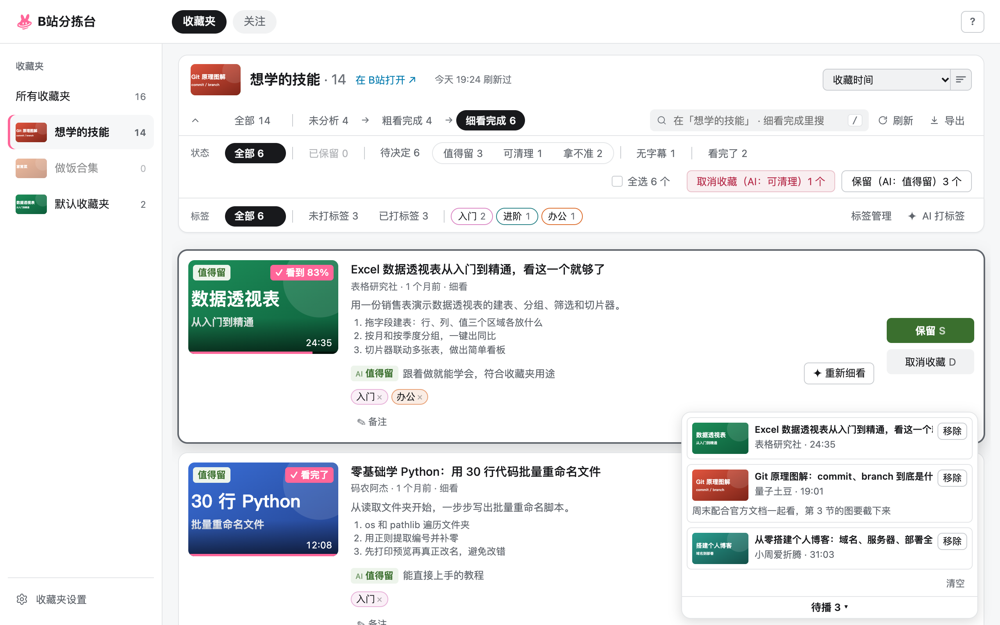

<div align="center">


# MoonDigest · 月团视频摘读

收藏了却没看的视频、想读的网页，用 AI 帮你读完、整理好，挑出真正要看的。

[](https://developer.chrome.com/docs/extensions/develop/migrate/what-is-mv3)
[](extension/manifest.json)
[](#功能)
[](LICENSE)

</div>

收藏了的视频、想读的网页，MoonDigest 帮你用 AI 读完、整理好。数据都留在你的浏览器里，没有作者的服务器。

<p align="center">
  
</p>

<p align="center"><a href="https://chromewebstore.google.com/detail/bnjihpbocpimaipifanfkjjpfdbigggd">安装</a> · <a href="docs/FAQ.md">常见问题</a> · <a href="https://github.com/PathGao/MoonDigest/issues">反馈</a></p>

## 快速开始

1. 从 [Chrome 应用商店](https://chromewebstore.google.com/detail/bnjihpbocpimaipifanfkjjpfdbigggd) 安装。
2. 设置 → 「AI 平台」 → 「+ 添加平台」，选预设，填 API Key，点「测试连接」。浏览器问能否访问这个地址时点允许。设置改了就存，不用点保存。支持 DeepSeek、智谱 GLM、Kimi、MiniMax、OpenRouter 和任意 OpenAI 兼容接口。可以加多个，在侧边栏的「选择 AI 平台」里切换；分拣台的 AI 也用这里选的平台。
3. 登录 B站。B站只给登录用户看字幕（AI 字幕也一样），分拣台也要登录才能读收藏夹。
4. 打开一个 B站或 YouTube 视频，点插件图标里的 **✦ AI 总结**。

带 ✦ 的按钮会调用 AI，花你自己的 API 额度，其他按钮不会。不配 AI 也能看字幕、下载字幕、用专注模式、导出笔记和手动分拣。

## 功能

**读**
- 看 B站和 YouTube 字幕（人工、AI、自动生成），复制或下载 SRT、TXT。没有字幕时，AI 用简介和热门评论总结。
- AI 侧边栏：总结视频或网页，接着追问。在普通网页上第一次用要点「允许读取网页」（Chrome 会申请读取所有网站）。
- 专注模式：视频在左，字幕在右，跟着播放滚动，点一句跳过去。

**理**（仅 B站）
- 分拣台：AI 先看标题、再读字幕，告诉你收藏夹里每个视频值得留、可清理还是拿不准，再由你保留或取消收藏。**取消收藏会真的在 B站取消**，按 U 可以撤销。详见 [分拣台说明](docs/TRIAGE.md)。
- 给视频和 UP 主打标签，B站页面上也能看到标签。AI 判断要在设置 →「B站分拣台」里打开才在 B站页面显示。
- 观看进度（默认关）：在封面上显示看到多少、看完了没有。

**记**
- 给视频写一句备注，AI 对话按视频和网页存进「摘读记录」，可以搜索、打星标和标签。加了星标的对话不会被「清空全部 AI 对话」删掉，也不计入对话上限。
- 导出 Markdown，或写入 Obsidian（可选，设置页有配置指引）。

<p align="center">
  
</p>

## 给 AI agent 用

Agent 碰到视频通常只能看标题和封面。装了 MoonDigest，agent 能借你浏览器的登录状态拿到视频的字幕、章节、简介和热门评论，还能截取任意一秒的画面。用 MCP 时，agent 还能借你的登录搜 B站和 YouTube 视频。不下载视频，不花 AI 额度，读不到你的 Key 和 AI 对话。你的收藏夹、关注、观看历史和分拣台里的标签、备注，只有打开「允许 Agent 读我的收藏、关注和历史」后才能通过 MCP 读；分拣台的 AI 判断、保留、备注和标签，再打开「允许 Agent 改分拣台」后 agent 才能写，取消收藏、移动和复制只能提议，要你在分拣台确认；B站稍后再看、YouTube 稍后观看和 YouTube 播放列表，再打开「允许 Agent 改我的收藏」后 agent 才能改。两种接法：

- **skill**（agent 能操控浏览器，如 ego、Claude in Chrome、Playwright）：

  ```sh
  git clone https://github.com/PathGao/MoonDigest.git
  mkdir -p ~/.claude/skills && cp -r MoonDigest/skills/moondigest ~/.claude/skills/
  ```

- **MCP**（Claude Code、Cursor、Codex 等）：在设置 → MCP 打开「允许 MCP 连接」（用时再开，不用时关掉），再装服务（要 Node 20+）：

  ```sh
  git clone https://github.com/PathGao/MoonDigest.git
  cd MoonDigest/mcp && npm install && claude mcp add moondigest -- node "$PWD/server.js"
  ```

  Cursor、Codex 的配置和注意事项见 [mcp/README.md](mcp/README.md)。插件会自动更新，MCP 服务不会：以前装过的，在 `MoonDigest` 目录里 `git pull` 后重开 agent，才能用上新工具。

不装 skill 也行，把这段提示词粘给 agent（用 MCP 时把第 1、2 步换成 get_video、get_frame，找视频用 search_videos）：

```text
需要了解 B站 或 YouTube 视频的内容时，包括查资料时搜到的视频，用浏览器打开视频页，不要只看标题和封面，也不要下载视频。浏览器里装了 MoonDigest 扩展，按 https://github.com/PathGao/MoonDigest/blob/main/skills/moondigest/SKILL.md 的步骤做：
1. 在视频页执行文档里的 JS，用 moondigest-get 拿字幕、章节、简介和评论。
2. 按章节读字幕。要核对画面（图表、代码、屏幕上的文字）时，用 moondigest-frame 跳到对应秒数截一帧，图片别直接打印进上下文。
3. 查资料搜到多个视频时，挑最相关的几个读，只引用或推荐真正讲了我要的内容的。结论带上时间戳（mm:ss）和能跳到那一刻的链接。
4. 没字幕、没登录 B站 或被限流时，告诉我原因，不要反复重试，一次只读一个视频。
```

接口说明见 [docs/AGENT.md](docs/AGENT.md)。

## 安装与更新

支持 Chrome 和其他 Chromium 内核浏览器（只在 Chrome 上测试过），不支持 Firefox。

- **Chrome 应用商店**（推荐）：自动更新。新版要等审核，通常比 GitHub 晚几小时到几天。
- **zip 包**：从 [Releases](https://github.com/PathGao/MoonDigest/releases/latest) 下载，解压到一个以后不会移动的文件夹，在 `chrome://extensions` 打开「开发者模式」，「加载已解压的扩展程序」。更新时**解压覆盖原来的文件夹**再点刷新；换一个文件夹加载，Chrome 会当成新扩展，原来的数据全部丢失。
- 商店版和 zip 版是两个扩展，数据不互通，二选一。装过 Bilibili Obsidian Clipper 的话先停用它。

## 隐私与数据

设置、分拣结果、备注、对话和 API Key 都存在你的浏览器里。插件只连 B站、YouTube、你配置的 AI 平台和你本机的 Obsidian；网页正文和字幕只在你提问或点带 ✦ 的按钮时发给你选的 AI 平台。没有作者的服务器，没有统计。每项权限的用途和各类数据的保存方式见 [PRIVACY.md](PRIVACY.md)。

## 更多

- [常见问题](docs/FAQ.md)：字幕抓取失败、限流、网页读不出正文、Obsidian 连接等。
- 路线图：问 AI 从收藏夹里挑视频清单；YouTube 播放列表的批量阅览。
- 贡献：欢迎提 [issue](https://github.com/PathGao/MoonDigest/issues)，报 bug 请写视频链接、浏览器版本和复现步骤。改代码见 [CONTRIBUTING.md](CONTRIBUTING.md)。
- 致谢：基于 [haixiong1997/Bilibili-Obsidian-Clipper](https://github.com/haixiong1997/Bilibili-Obsidian-Clipper)（MIT）；YouTube 字幕的取法参照 [yt-dlp](https://github.com/yt-dlp/yt-dlp)；感谢 [oil-ui](https://github.com/oil-oil/oil-ui) 在 UI 设计迭代中的支持。
- 许可：Copyright (C) 2026 PathGao，以 [GPL-3.0](LICENSE) 发布，来自上游的部分保留 MIT 声明，见 [THIRD_PARTY_NOTICES.md](THIRD_PARTY_NOTICES.md)。使用须遵守 B站用户协议，见 [免责声明](PRIVACY.md#免责声明)。

## 请杯咖啡助力UP开发

<p align="center">
  
  &nbsp;&nbsp;
  
</p>
