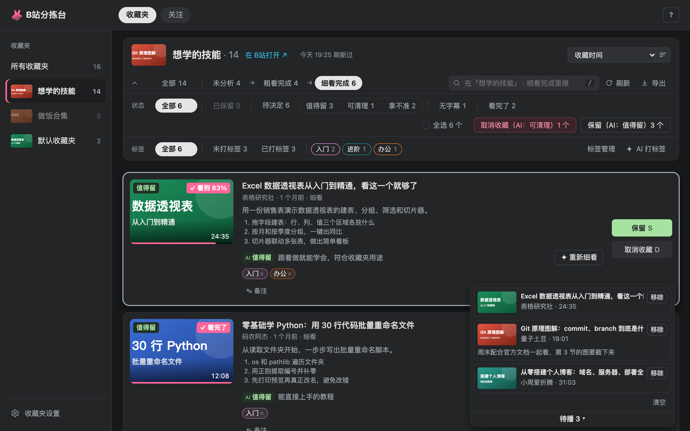

# B站分拣台

点插件图标 → **打开B站分拣台**。第一次打开先勾选要分拣的收藏夹，B站「稍后再看」也可以勾。MoonDigest 只读取你勾选的收藏夹，没勾的不读内容。

## 两层：判断标准和标签

分拣台回答两个问题。视频**留不留**，看收藏夹的判断标准，AI 给出 **值得留** / **可清理** / **拿不准**。留下的**怎么分**，看你的标签。

```
收藏夹「想学的技能」  判断标准：只留能跟着做的教程和讲透原理的内容，带货和标题党可清理
   ├─ AI 判断 ─▶ 值得留 / 可清理 / 拿不准 ─▶ 你决定：保留 / 取消收藏
   └─ 标签 ───▶ 入门  进阶  办公
```

- **判断标准**：「✎ 判断标准」按钮，没写时带一个小点。不写时，AI 从收藏夹名和简介推测用途。改了标准以后，按旧标准做的结果可以「按新标准重新粗看 / 细看」。
- **标签**属于各自的收藏夹，每个收藏夹默认最多 10 个（收藏夹设置里可改，1–50），一个视频可以打多个。标签那一行的「标签管理」里改名、写说明、删除，**✦ AI 打标签** 用一句话让 AI 给一批视频打标签（每次默认最多新建 5 个，收藏夹设置里可改），你检查后再应用。
- 两层互不影响：打标签不算处理，AI 判断也不改你的标签。

## 四个步骤

步骤表示 AI 看到了哪一步。AI 判断是每个步骤里的筛选。

| 步骤 | 里面是什么 | 你做什么 |
|---|---|---|
| 未分析 | AI 还没看过的 | 点 **✦ 标题粗看下一批**。AI 只看标题和简介，一次跑 100 个（最多 1000），每次请求带 20 个标题，便宜 |
| 粗看完成 | AI 看过标题的 | 拿不准的点 **✦ 字幕细看下一批**（读字幕，每批默认 10 个，最多 50）。有把握的可以直接保留或取消收藏 |
| 细看完成 | AI 读过字幕的，判断最可靠 | 看 AI 总结和要点，一个个或批量保留、取消收藏 |
| 处理完成 | 你处理过的 | 后悔了可以重新收藏，整批取消收藏的可以整批重新收藏 |

- **保留**只在 MoonDigest 里标记，B站收藏夹不变。**取消收藏**会真的在 B站取消，按 U 可以撤销。
- **阅览全部**：整个收藏夹一页看完，同样能按 AI 判断筛选。
- 粗看、细看、批量取消收藏和移动在切换收藏夹后继续跑，进度显示在进度胶囊里。关掉分拣台页面就暂停。
- 标题粗看和字幕细看有选中时只跑选中的（最多一批）；选中的都不能跑时按钮灰掉，不改跑下一批。AI 回复出错的视频标「分析失败」排在最后，可以逐个或整批重试；Key、余额、连不上这类 AI 平台的问题会停下并提示去设置。
- 收藏夹设置里能调请求间隔、两步的每批数量和输出上限。分拣台用的是 DeepSeek、智谱或 Kimi 时还有「开启思考」开关：关着快、省；开着判断更细，但慢得多、token 多几倍。

## 选中和批量操作

- 点卡片（标题和按钮以外的地方）或按 X 选中，再点一次取消；或勾「状态」行的「全选 N 个」（再勾一次取消）。点标题是在分拣台里播放。Shift 点一张选中从上一次点的那张到这张的一段；按 Esc 或「清空选中」全部取消。⌘ / Ctrl 点标题照样在 B站打开。关注的 UP 主卡片也一样。
- 选中只属于当前这一页，切到别的步骤或阅览就清空。跑一步或批量操作以后选中不变，只有因此离开这一页的才不再选中。被搜索或筛选藏起来的选中不算进操作，选中条上会写「另有 N 个被筛选隐藏」（都被藏起来时写「已选中 N 个」和「都被筛选隐藏」）；选中的都被藏起来时，按钮照样对着选中、写选中的个数，灰掉并写「选中的都被筛选隐藏了」。
- 选中后可以保留、取消收藏，或 **移动 / 复制** 到你 B站账号里的任意收藏夹，也可以新建一个（可设私密）。
- 移到没勾选的收藏夹时，视频进「已出分拣范围」并标出去向。之后在收藏夹设置里勾选那个收藏夹，它们会自动回来。
- **「导出」菜单**：「摘录或笔记…」的范围选当前筛选、选中或整个收藏夹（待播不参与导出），格式选一篇摘录（带每个视频的备注）或逐个视频笔记（字幕加 AI 总结），可以复制、下载或写入 Obsidian。也能导出 JSON 完整备份（不含密钥和待播）和当前收藏夹的 CSV 表格。

## 待播

分拣时想先看或要核对的视频，按 E（或卡片上的「+ 待播」）加入待播，卡片上变成「✓ 待播」，再按 E 或点它从待播移除。待播跨收藏夹，按加入先后排。点一条就在分拣台里打开 B站视频页（登录状态，能点赞、评论）。每条的「移除」把它从待播移除，「清空」一次移除全部，都可以按 U 撤销。在「已出分拣范围」清理掉的视频也会从待播移除。

待播只管看的顺序，不改收藏和处理结果。点卡片标题、按 O 或回车也在分拣台里打开，Esc 关闭。

## 其他视图

- **所有收藏夹**：把勾选的收藏夹合在一起看和搜索。第一次要逐个加载，之后只核对有变化的。AI 粗看、细看和 AI 打标签也能在这里做：每个视频按它排在最前的收藏夹的判断标准判断，标签按收藏夹分开打。批量保留和批量取消收藏也能在这里做，取消收藏时勾选从哪些收藏夹取消。
- **稍后再看**：和收藏夹一样分拣，卡片上标出在 B站看到了哪里。
- **已出分拣范围**：视频离开了你勾选的所有收藏夹（在 B站取消收藏、移到没勾选的收藏夹、收藏夹被删、或你取消勾选），它的 AI 判断、AI 总结、备注和标签先放这里，不会悄悄丢掉。打开时逐个问 B站这个视频还在哪些收藏夹里（和 B站收藏按钮弹出的是同一份信息，不读没勾选收藏夹的内容），上方页签分「全部」「已取消收藏」「在未勾选收藏夹」「已失效」。也可以按 AI 判断、标签、看完了筛选，选中后收藏到任意收藏夹，或导出后清理。
- **从 B站刷新**：打开收藏夹时核对 B站的变化，只补有差别的部分。点「刷新」重新读取整个收藏夹。刷新结果列出新增、来自其他收藏夹、已移除和已失效的视频。
- **已失效**：B站把视频换成占位信息时，保留原来的标题、封面、UP 主和简介。被 B站隐藏的失效视频进「已出分拣范围」，标「已失效（B站已隐藏）」。有失效视频时出现「已失效 N」筛选，配合全选可以一次处理。
- 同时开两个分拣台标签页也不会互相覆盖。弹窗和设置页的分拣台入口会先切到已经打开的那个；摘读记录的入口（弹窗、侧边栏、设置页）也一样。

## B站页面上的标记

分拣过的视频，在 B站页面上也能看到结果：视频标题前面带你的视频标签，UP 名字后面带 UP 标签。AI 判断（「AI 值得留」「已保留」「已取消收藏」，虚线框表示只做过标题粗看）默认只在分拣台里看，想在 B站页面也看到，在设置页「B站分拣台」里打开；打开后视频页标题下面还多一行一句话总结。设置页那里还有一张表，按页面（首页、顶栏弹窗、动态、视频页、收藏夹、稍后再看、历史、UP 空间）勾选每种标记显示不显示。

<p align="center">
  
</p>

## 快捷键

| 按键 | 作用 |
|---|---|
| `J` / `↓`、`K` / `↑` | 下一个、上一个 |
| `S` | 保留 |
| `D` | 在 B站取消收藏（按 U 撤销） |
| `U` | 撤销上一步 |
| `X` | 选中或取消选中（同点卡片） |
| `T` | 打标签 |
| `I` | AI 打标签 |
| `E` | 加入待播 / 从待播移除 |
| `Q` | 问 AI（在侧边栏打开这个视频） |
| `O` / `Enter` | 在分拣台里打开视频页（Esc 关闭） |
| `/` | 搜索（Esc 清空） |
| `?` | 快捷键帮助 |

「已出分拣范围」里卡片键只有 `E`、`Q`、`X`、`O` / `Enter` 可用，`U` 照常撤销上一步；点卡片选中。
